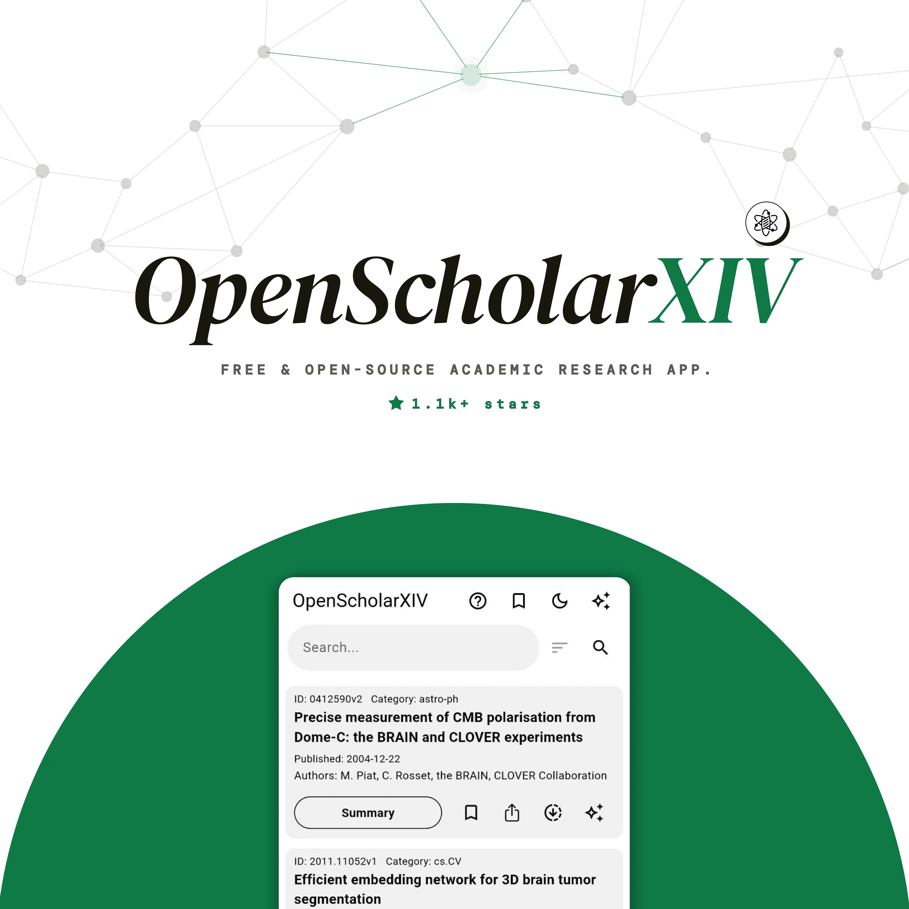
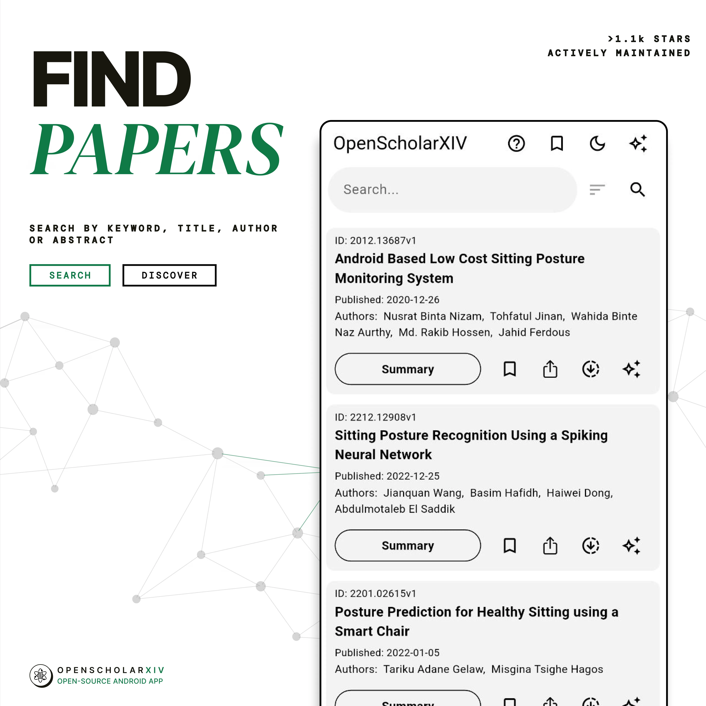
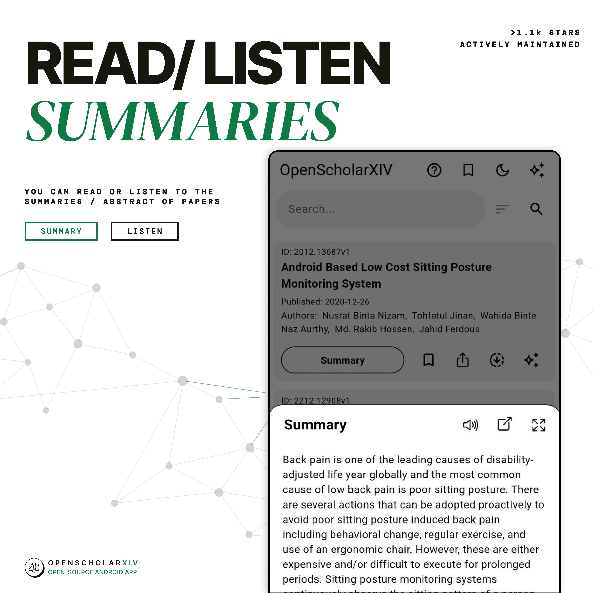
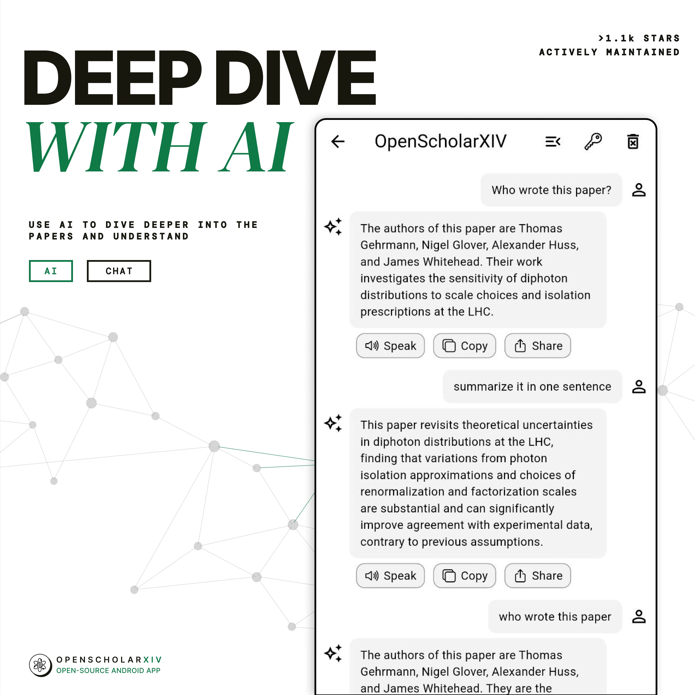
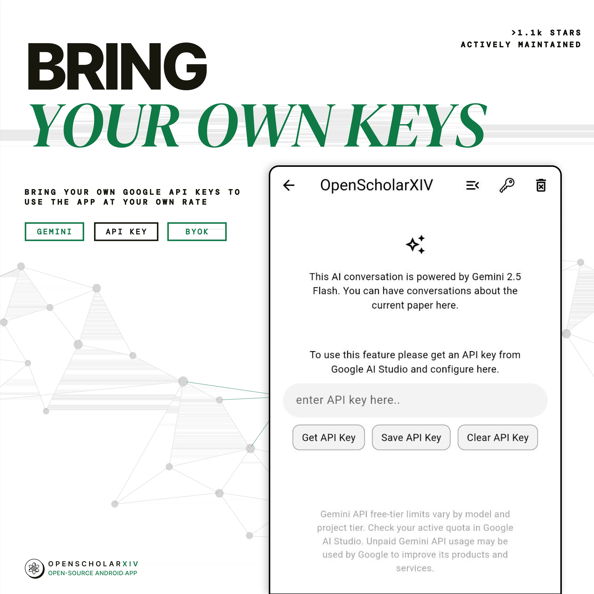
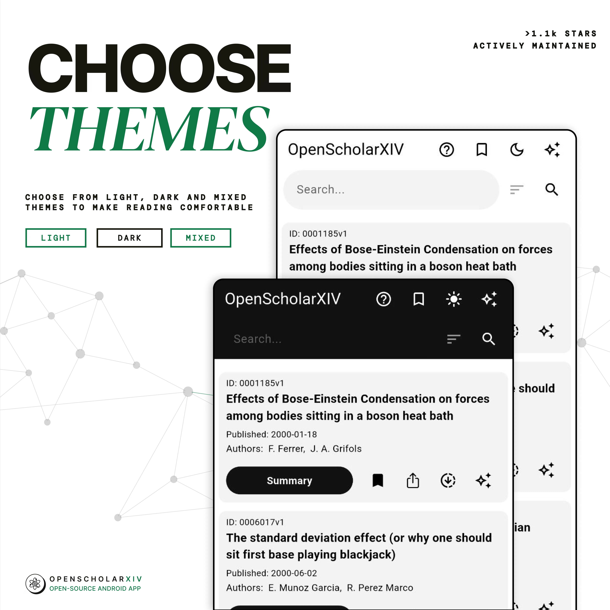
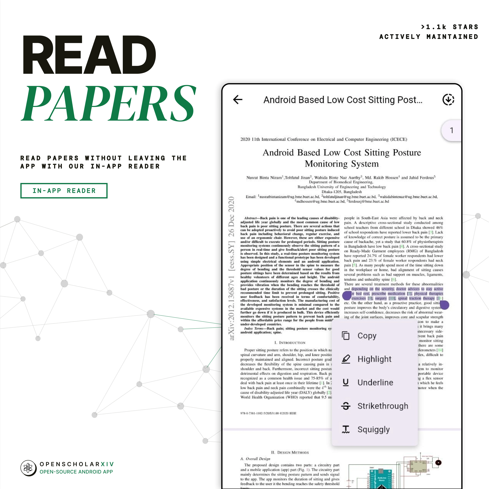
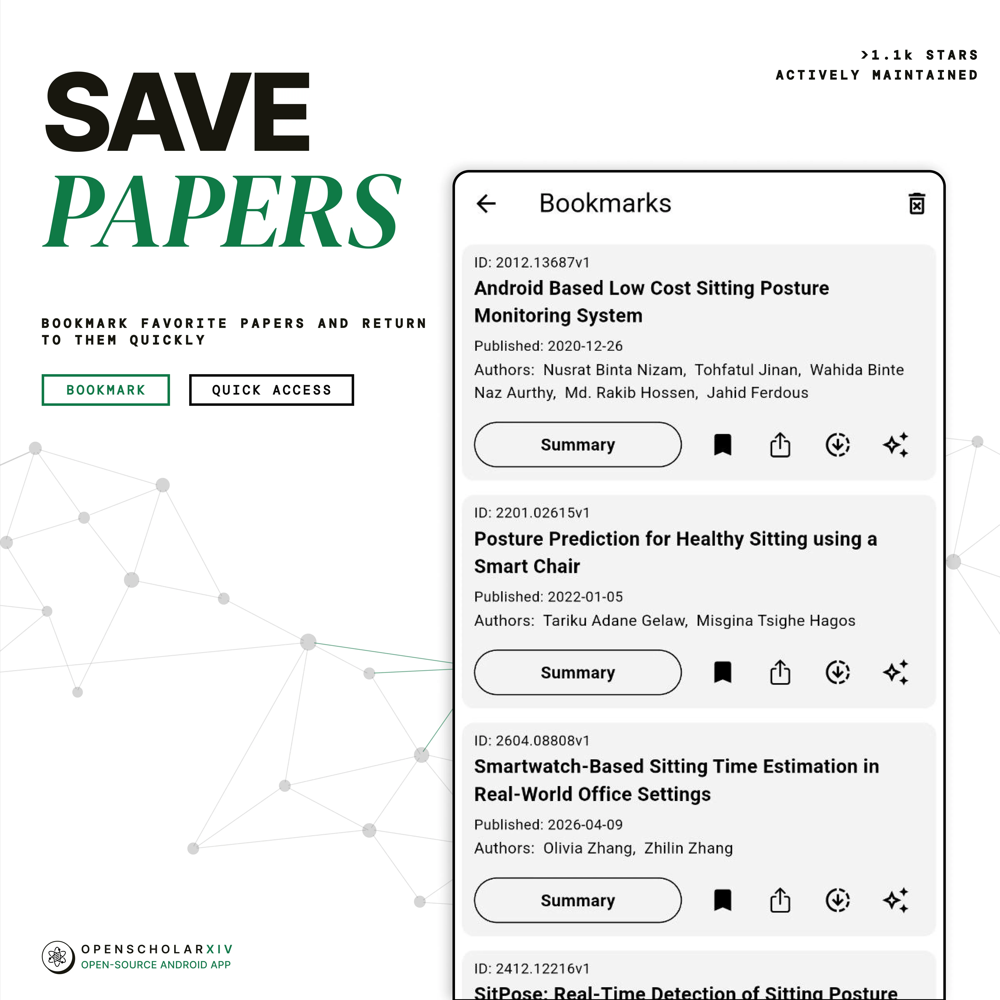

# OpenScholarXIV (Android Fork by hydrogen)

> **Note:** This Android-focused fork and its modifications are maintained by **hydrogen**, based on [ScholarXIV/OpenScholarXIV](https://github.com/ScholarXIV/OpenScholarXIV). Currently only the `android` branch is maintained.

OpenScholarXIV is a free and open-source app for finding, reading, bookmarking, summarizing, and discussing arXiv papers with AI.

  

## Modifications by hydrogen

- **Search & Discovery**: Full arXiv category taxonomy with folded category groups, arXiv Advanced Search (`ti:`, `au:`, `abs:`, `co:`, `jr:`, `cat:`, `submittedDate`), arXiv ID/URL quick-jump, and `Newest` sort order by default.
- **Feed & Refresh UX**: Schedule-aware pull-to-refresh matching arXiv's Sun–Thu 20:00 US/Eastern announcement schedule (plus weekend/holiday reminders), folded author lists with expand toggles, and configurable session restore (category-only by default, or full search filter).
- **Paper Details & LaTeX**: Fixed MathJax/LaTeX rendering in abstracts and titles, tap-to-copy abstract/PDF metadata links, and external **References & Citations** jump links (INSPIRE HEP, NASA ADS, Google Scholar, Semantic Scholar).
- **AI & Settings**: Support for both Google Gemini (2.5+) and OpenAI-Compatible providers, organized Appearance and Main Page Style submenus.
- **Android Build & CI**: Migrated to AGP 9.3.1 / Gradle 9.5.0 / Built-in Kotlin, enabled R8 shrinking + WebP banners, and added Android-only GitHub Actions CI (ARM64 & ARMv7 split APKs).

## Features

- Find papers with search and suggested research papers.
- Read papers in-app without leaving OpenScholarXIV.
- Bookmark papers to revisit them later.
- Read and listen to paper summaries.
- Deep dive into papers with AI chat.
- Bring your own Gemini API key.
- Choose between Material You light and dark themes.
- Download and share papers.

## Screens

  
  
  
  
  
  <!---->
  
  
  
  
  
  
  

## Contributing

Fork the repo, make your changes, and open a pull request. You can also use the issues tab for contribution ideas.

## License

This project is licensed under the GNU General Public License.

## Acknowledgements

Thank you to arXiv for the use of its open access interoperability.

Made by [ScholarXIV](https://ScholarXIV.com).
